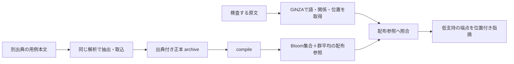

# 日本語の語彙選択・連語誤用の検出

「重複を畳む」のような語の使い方を用例に照らし、確認が必要な名詞・述語を原文位置付きで返します。GiNZAの公開文節API（NER除外）、Bloom集合索引、名詞群の平均を使い、Python・CLI・textlintから利用できます。訂正案は未実装です。



[セットアップ](docs/setup.md)後、出典本文から参照を作って検査します。資源・原文・生成DBはGit外へ置きます。

```sh
. .venv/bin/activate
ASSETS=/path/to/assets
ARCHIVE=/path/to/examples.sqlite3
REFERENCE=/path/to/reference.sqlite3
native-japanese extract --source-id source-001 --source-url 'https://example.org/source' source.txt > /path/to/examples.jsonl
native-japanese import --examples "$ARCHIVE" /path/to/examples.jsonl
native-japanese prepare --examples "$ARCHIVE" --reference "$REFERENCE" --assets-dir "$ASSETS"
native-japanese lint --reference "$REFERENCE" --assets-dir "$ASSETS" input.txt
```

検査端末に用例全文DBや全出典を配る必要はありません。正本は更新・再compile時に使い、検査には配布参照とモデルを使います。異なる組合せN、群G、次元d=300、保存する文字列量Lに対し、参照保存は `O(N log(1/p) + Gd + L)`、誤認率p固定では線形です。同じ組合せの頻度・出典だけを増やしても、配布集合と群平均は増えません。

自然参照1,024記事＋追加1記事では、約6.9万組合せ・1.9万群の配布参照が約71.2MB、Python本体・モデル・依存を含む検査環境が約913MBでした。この規模では群平均の保存によって配布参照は正本より大きくなります。100万件のBloom単体2.89MBという部品値を総容量とは扱いません。

`indexed`は近似索引の一致で、低確率の誤通過があり、実用例の直接確認を意味しません。陰性だけでは警告せず、比較可能な群の支持が暫定境界0.35未満なら確認を促します。比較不能は理由付きで残します。支持は正誤確率ではありません。

全件正答や未収録語の解消を完成条件にせず、所定形式の情報追加で改善でき、費用を現実的に増やせることを目指します。正用同士の意味差、文章のもっともらしさ、AI生成判定は対象外です。

固定38本文では、別出典追加で「世界的な大ヒット」の比較不能を1件解消しましたが、指摘位置は不変でした。「重複を畳んでいる」は今回の小規模参照に該当群がなく保留です。短文6種の反復は18〜182ミリ秒、初期化と初回には別途秒単位の費用がかかります。一般の検出精度や全入力のリアルタイム性を保証する結果ではありません。

- [現在の採用方針・検証範囲](docs/compact-runtime-plan.md)／[構成と容量](docs/architecture.md)
- [自然参照の容量・速度・用例追加・実接続の検証結果](docs/compact-runtime-validation.md)
- [API・CLI・用例形式](docs/runtime.md)／[textlint接続](docs/textlint.md)
- [旧KNP方式の検証記録](docs/runtime-validation.md)は履歴です。旧方式の成績・遅延を現方式の結果へ転用しません。
