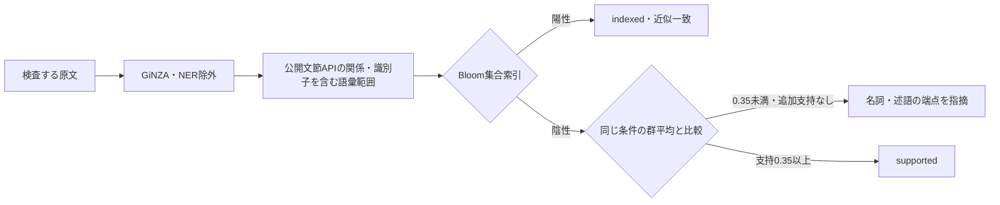
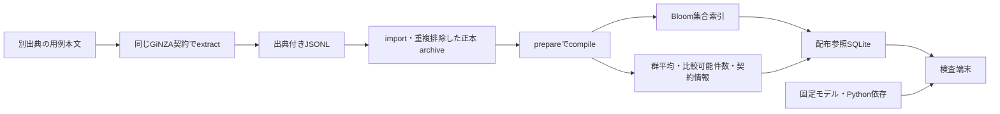

# 現在の解析・照合構成

AIが出した日本語から、用例に裏付けられない語の使い方を位置付きで指摘する。所定形式の情報追加で改善でき、容量・構築・検索費用を現実的に増やせることを完成条件とする。全件正答、全用例収録、訂正案は今回の必須条件ではない。採用根拠と検証範囲は[最新方針](compact-runtime-plan.md)を参照する。

## 原文から位置付き指摘まで

解析契約は`ginza-bunsetu-lemma-no-ner-identifier-roles-v7`。GiNZA 5.3.0、ja_ginza 5.3.0、spaCy 3.8.16、SudachiPy 0.6.11、SudachiDict-core 20260723を固定し、`spacy.load("ja_ginza", exclude=["ner"])`で読む。以下の修正版を通じてGiNZAの文節APIが返す元の依存辺を読む。
`nsubj`・`obj`・`iobj`・`obl`は従属側を名詞役割、その元headを述語役割として、
`acl`・`amod`はheadを被修飾名詞役割、従属側を述語役割として受け取る。
これらの公開役割と方向を品詞による選別より優先し、元のUPOSをQueryに保存する。
その他のラベルでは、従来のNOUN/PROPNとVERB/ADJの両方向の経路を維持する。名詞側の公開`tag_`の品詞階層に「助動詞語幹」を含む候補は語彙照合へ送らない。公開句が元の主辞トークンを含むことと原文位置を検査し、不足を独自の構文・活用・助詞規則で補修しない。

句の取得はGiNZA 5.3.0への最小修正版`5.3.0+nativejapanese.2`を使う。`bunsetu_phrase_span(..., use_token_head=True)`で、既存探索の開始点だけを文節span.rootから指定Tokenへ変える。`bunsetu_phrase_tokens`は同じ探索が選んだ元Tokenだけを原文順で追加公開する。
表示・原文位置には従来の包絡Spanを使い、比較lemmaには選択Tokenだけを使う。
間の非選択Tokenは照合へ混ぜない。選択集合そのものは正しい語彙境界の保証ではなく、
元の誤compoundや依存ラベルを訂正しない。既定動作、文法・lemma・依存辺・文節境界は変えない。wheelと差分・上流情報・MIT帰属は`vendor/ginza`に置き、uvのlocal path sourceで固定する。Sudachiの形態素辞書は語・品詞・活用の解析用であり、名詞一般化には別資源である既存の圧縮fastTextを使う。

識別子の語彙範囲は、元のSudachi/GiNZA pipelineが返すDocから取得する。token・品詞・依存辺・文節は変更しない。[UAX #31のprofile](https://www.unicode.org/reports/tr31/tr31-45.html)をASCIIに限定した`[A-Za-z_][A-Za-z0-9_]*(?:[.-][A-Za-z0-9_]+)*`のうち、ピリオド・アンダースコア・ハイフンを含むものを対象とする。直前に同じ文字集合の文字がある途中位置からは開始せず、数字やピリオドで始まる文字列の途中を全名としない。[`Doc.char_span`](https://spacy.io/api/doc#char_span)のstrict指定で元tokenの境界と一致する範囲だけをSpanにする。同じ原文には.md/.txtで同じ処理を適用し、語別一覧・学習・用例追加を使わない。

両端のtokenが同じ識別子内にある辺は語彙内部の関係として独立照会から外し、Docの辺自体は残す。識別子内でも元の端点tokenの役割とPOS/tagを保持し、名前全体を名詞と決めたり、Span.rootの型で読み替えたりしない。句の探索は元の端点tokenから行い、名前の一部を含む句は名前全体を含む範囲に広げる。これにより`js 20.18以上`は`Node.js 20.18以上`となり、「標準re.finditer」の「標準」のような外側の語も保持する。範囲を広げた述語句と名詞句が重なる場合は、その関係では両方の範囲拡張と識別子の一項化を行わず、元の公開句を表示し、識別子へ投影せず選択Tokenのlemmaで照合する。関係自体は削除せず、元の句解析を推測で修復しない。依存先をrootへ付け替えたり、tokenを結合したりしない。複数tokenのSpanを関係の引数とする考え方は[spaCy公式の関係抽出実装](https://github.com/explosion/projects/blob/v3/tutorials/rel_component/scripts/rel_model.py)にもあるが、その学習モデルは導入しない。

照会キーは述語役割の語彙配列と元UPOS、元依存ラベル、名詞役割の語彙配列と元UPOS、名詞の元方向（head/dependent）。
役割と品詞は別の情報であり、両側とも[標準UD品詞](https://universaldependencies.org/u/pos/)を保持する。
例えば「再利用」がNOUNでも既存obj/nsubj/oblのheadなら述語側へ渡し、
「基本形」がADJでも既存objの従属側なら名詞役割へ渡す。POSを付け替えない。
同じ語でも元UPOSが違えば別の照会キーとなり、用例を暗黙に共有しない。語彙配列では、選択Tokenに属する上記の重なりがない関係の識別子全体を原文表記一項、それ以外を選択Tokenのlemmaとし、名前内部のlemmaを重ねて加えない。`Token.is_space`が真の空白は語彙に含めず、空白を主辞とする候補も照合しない。表示は句内の非空白tokenの先頭から末尾までとし、内部の原文の空白は保持する。両端の原文位置と全Queryが一致するRelationだけは、元の順序を保って一度返す。旧KNPの意味格や用例とは互換にせず、自動変換しない。

READMEの「『重複を畳む』のような語の使い方」では、「よう」はNOUNだが詳細品詞は「形状詞-助動詞語幹」である。v2では「畳む」から「よう」へのnmodを語彙照合へ送り、支持がないと表現の見直しを求めていた。v3で既存辞書の「助動詞語幹」という分類に沿う対象選択へ変更した。形状詞・名詞のどちらの階層に属する場合も同じ分類を読み、単語の一覧や依存ラベルの一括除外は使わない。v4でこの対象選択を保持して非語彙の空白の扱いを修正し、v5で識別子の語彙範囲を加え、v6で表示用の包絡範囲と比較用の選択Tokenを分け、v7で公開依存関係の役割を元UPOSから分離して読む。元Docの品詞・依存・lemma・文節は変えず、引用内の「重複を畳む」のobjや「本を読む人」のaclは引き続き照合する。旧契約の参照とは混用せず、同じ本文から現契約で再生成する。

役割読取は[UDの名詞項関係](https://universaldependencies.org/u/dep/all.html)が既に示す方向の転記であり、
NOUNを動作と認定する処理ではない。「モデルが約22MB」「ことが選択理由」や
「ねこはとしより」のような数量・名称・名詞述語も、元の主語等の関係が公開されていれば候補になる。
意味的な動作分類、全名詞対の列挙、名詞同士のnmod/compoundの追加は行わない。
auxの存在・語の表記・「する」等を追加条件にせず、元Docにない関係も生成しない。
従来の他ラベルの候補はこの接続修正で削らない。元解析の誤辺や誤った句選択は修復されず、
役割を欠落せず転記できることと、指摘の妥当性は分けて検証する。

Bloom陽性の`indexed`には低確率の誤通過があり、実用例を直接確認済みとは表示しない。陰性なら名詞一般化による追加支持を確認する。名詞lemma配列以外の条件を固定した群に対し、入力名詞の合成ベクトルと事前平均の方向を比較する。異なる名詞配列を等票とし、頻度・出典数で加点しない。支持は正誤確率ではなく、新群の値を旧格フレームの値と同一視しない。

Bloom陽性でも類似度0.35以上でもない関係は、名詞・述語それぞれの端点を通常のerrorとして指摘する。未収録群やベクトル不能は追加支持なしとし、類似度0を捏造しない。解析失敗・不正な数値・資源破損はsystemerrorとする。支持の欠如を日本語全体での不存在と解釈しない。Python APIの位置は文字添字、CLI・JSONLではUTF-16へ変換し、textlintが原文へ戻す。訂正案は未実装。

## 用例の構築と配布を分ける

構築・監査用正本は組合せと全出典対応を保存する。原文全文はJSONL・正本DBへ保存しない。配布参照はBloom、群平均、件数、固定資源・正規化契約を保存し、検査時に正本・全出典・全用例の個別ベクトルを要求しない。正本は追加取込と再compile時に保持する。追加は再compileによって集合と群平均へ反映される。

異なる組合せ数N、群数G、次元d=300、配布参照の文字列量L、Bloomの誤認率pに対して保存は `O(N log(1/p) + Gd + L)`。p固定では線形で、全名詞対や入力×用例の行列を作らない。同じ組合せの頻度・出典対応だけが増えても、配布集合・群平均は増えない。正本の出典対応保存は別途増える。固定容量を超える前に正本から再構築し、フィルターを際限なく追加しない。

100万件のBloom単体2,885,411 bytesは人工キーでの部品実測。平均はf64で2,400 bytes/比較可能群に、キー・件数・SQLite管理領域が加わる。v1解析契約での[従来の自然参照の検証](compact-runtime-validation.md)では、約6.9万組合せの配布参照は約71.2MBで、群平均を持つため約52.9MBの正本より大きかった。モデル・解析辞書・Python本体・依存等を含む検査環境は約913MB。部品だけの圧縮率と、全体の導入容量を区別する。

## 検証記録の扱い

現行方式の検証は[最新方針](compact-runtime-plan.md)に従う。[旧実装方針](incremental-runtime.md)、[旧実経路の結果](runtime-validation.md)、[初期試作](minimal-validation.md)は履歴として保持する。旧方式の成績・用例追加効果・遅延を現方式の成績へ転用しない。原文と構築用正本はGitへ含めない。配布用の固定モデルと参照DBはGit LFSで管理する。
