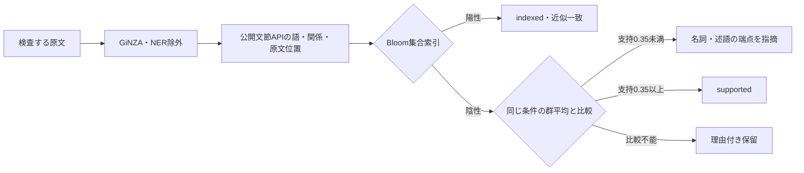
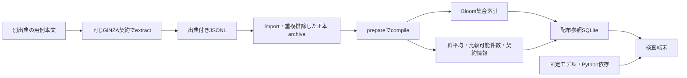

# 現在の解析・照合構成

AIが出した日本語から、用例に裏付けられない語の使い方を位置付きで指摘する。所定形式の情報追加で改善でき、容量・構築・検索費用を現実的に増やせることを完成条件とする。全件正答、全用例収録、訂正案は今回の必須条件ではない。採用根拠と検証範囲は[最新方針](compact-runtime-plan.md)を参照する。

## 原文から位置付き指摘まで

解析契約は`ginza-bunsetu-lemma-no-ner-v1`。GiNZA 5.3.0、ja_ginza 5.3.0、spaCy 3.8.16、SudachiPy 0.6.11、SudachiDict-core 20260723を固定し、`spacy.load("ja_ginza", exclude=["ner"])`で読む。公式文節APIが返す依存辺のうち、NOUN/PROPNとVERB/ADJの関係を両方向で選ぶ。公開句が元の主辞トークンを含むことと原文位置を検査し、不足を独自の構文・活用・助詞規則で補修しない。

照会キーは述語句のlemma配列、述語品詞、元依存ラベル、名詞句のlemma配列、名詞品詞、名詞の元方向（head/dependent）。旧KNPの意味格や用例とは互換にせず、自動変換しない。

Bloom陽性の`indexed`には低確率の誤通過があり、実用例を直接確認済みとは表示しない。陰性だけで誤用としない。名詞lemma配列以外の条件を固定した群に対し、入力名詞の合成ベクトルと事前平均の方向を比較する。異なる名詞配列を等票とし、頻度・出典数で加点しない。支持は正誤確率ではなく、新群の値を旧格フレームの値と同一視しない。

支持が暫定境界0.35未満の関係では、名詞・述語それぞれの端点を指摘する。未収録群、ベクトル不能、解析情報不足は理由付きの比較不能として残す。Python APIの位置は文字添字、CLI・JSONLではUTF-16へ変換し、textlintが原文へ戻す。訂正案は未実装。

## 用例の構築と配布を分ける

構築・監査用正本は組合せと全出典対応を保存する。原文全文はJSONL・正本DBへ保存しない。配布参照はBloom、群平均、件数、固定資源・正規化契約を保存し、検査時に正本・全出典・全用例の個別ベクトルを要求しない。正本は追加取込と再compile時に保持する。追加は再compileによって集合と群平均へ反映される。

異なる組合せ数N、群数G、次元d=300、配布参照の文字列量L、Bloomの誤認率pに対して保存は `O(N log(1/p) + Gd + L)`。p固定では線形で、全名詞対や入力×用例の行列を作らない。同じ組合せの頻度・出典対応だけが増えても、配布集合・群平均は増えない。正本の出典対応保存は別途増える。固定容量を超える前に正本から再構築し、フィルターを際限なく追加しない。

100万件のBloom単体2,885,411 bytesは人工キーでの部品実測。平均はf64で2,400 bytes/比較可能群に、キー・件数・理由・SQLite管理領域が加わる。モデル・解析辞書・Python依存・構築中の一時領域は別であり、この値から総容量や日本語の検出精度を断定しない。

## 検証記録の扱い

現行方式の検証は[最新方針](compact-runtime-plan.md)に従う。[旧実装方針](incremental-runtime.md)、[旧実経路の結果](runtime-validation.md)、[初期試作](minimal-validation.md)は履歴として保持する。旧方式の成績・用例追加効果・遅延を現方式の成績へ転用しない。資源・原文・モデル・生成参照はGitへ含めない。
