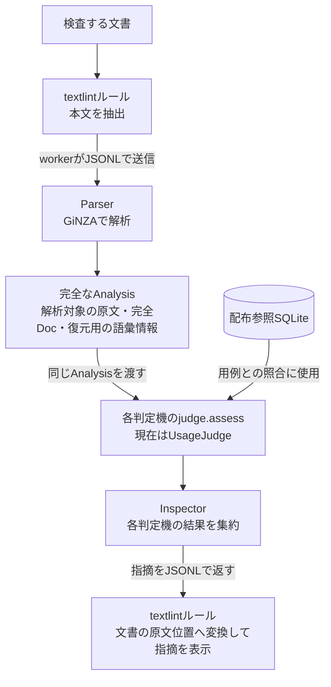
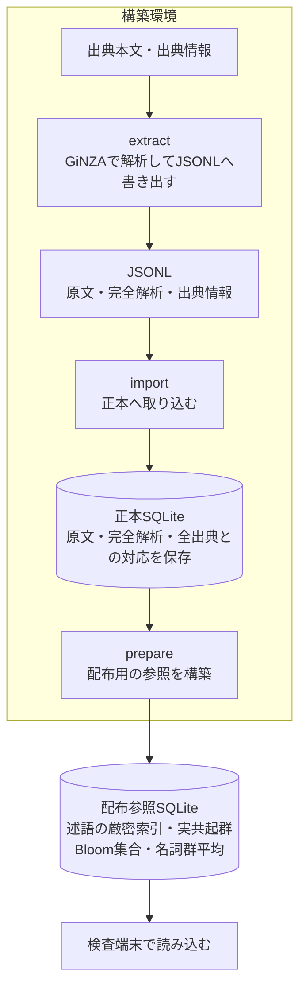

# システムの構成

## 構成と責務

| 部品 | 責務 |
| --- | --- |
| [textlintルール](../../packages/textlint-rule-preset-native-japanese/src/index.js) | 本文抽出、原文への位置変換、指摘表示 |
| [worker](../../packages/textlint-rule-preset-native-japanese/src/worker.js) | JSONL通信、要求と応答の対応、プロセス共有 |
| [runtime](../../packages/textlint-rule-preset-native-japanese/src/runtime.js) | uvによるPython環境の準備と起動 |
| [Parser](../../src/native_japanese/parser.py) | 原文・GiNZAの完全Doc・復元に必要な語彙情報を`Analysis`へ保持 |
| [Inspector](../../src/native_japanese/service.py) | 同じ完全`Analysis`を各判定機へ渡し、結果を集約 |
| [UsageJudge](../../src/native_japanese/service.py) | 用法照合用の局所viewを検証し、参照照会から支持を判定 |
| [比較view](../../src/native_japanese/comparison.py) | 用法照合で参照する元Token・辺・述語構成・関係・名詞特徴を同定 |
| [語彙保存](../../src/native_japanese/vocabulary.py) | 固定Vocab全資源と親付きの不変な差分世代を共有し、各解析時点のVocabへ独立復元 |
| [Examples](../../src/native_japanese/examples.py) | 原文・完全解析・全出典を保存し、再構築可能な索引を作成 |
| [Reference](../../src/native_japanese/reference.py) | 厳密な述語・関係索引、Bloom集合、名詞群平均の構築・読込 |

## データの流れ

### 本文の検査

`UsageJudge`は、受け取った完全な`Analysis`から用法照合に必要な語の関係を取り出して検証し、参照へ照会します。この処理は判定機の内部で行い、他の判定機へ渡す情報を絞りません。入力と参照には共通の[比較条件](usage.md)を適用します。

### 参照の構築

## 実行・配布

`Inspector`は解析器と参照を呼出し間で再利用します。位置単位と通信は[API仕様](../reference/runtime.md)、本文範囲は[textlint仕様](../reference/textlint.md)で定義します。

モデル・配布参照はGit LFSで管理し、npm配布物へ実体を同梱します。資源のID・ハッシュ・出典は[manifest](../../packages/textlint-rule-preset-native-japanese/assets/manifest.json)と[帰属資料](../../packages/textlint-rule-preset-native-japanese/THIRD_PARTY_NOTICES.md)にあります。原コーパス本文と構築用正本は同梱しません。

Pythonの取得と依存同期は既存uvへ委ね、初回だけ利用者cacheへ準備します。用例追加後は正本から配布参照を全量再構築し、検査器を起動し直します。

保存量は異なる用法数N、群数G、次元d、文字列量L、Bloom誤認率pに対し`O(N log(1/p) + Gd + L)`です。厳密な述語索引の文字列量もLに含めます。同じ用法の出典だけを増やしても配布集合と群平均は増えません。正本の原解析・出典対応と、全量再構築の費用は別に増えます。

## 採用理由

- GiNZAは必須依存のspaCy・Sudachiを通じて語・文節・依存関係を提供します。[公開文節API](https://github.com/megagonlabs/ginza/blob/v5.3.0/ginza/bunsetu_recognizer.py)を読み、別の解析器で結果を重ねません。
- [spaCy retokenizer](https://spacy.io/api/doc#retokenize)で識別子の境界を解析前に揃え、解析後に名前を付け替える不整合を避けます。
- N–P関係のBloom集合は低確率の誤通過を許容して所属判定を圧縮し、名詞群平均は検査端末への全用例ベクトルの配布を省きます。P–P関係は厳密な実共起群の存在だけで判定します。
- [uv](https://docs.astral.sh/uv/concepts/python-versions/)へPythonの取得・依存同期を委ねます。npm側の起動処理は配布済みbinaryを解決します。
