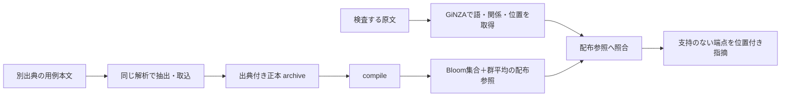

# 開発と資源の構築

他のプロジェクトへの導入は[セットアップ](setup.md#他のプロジェクトで使う)を参照してください。この文書は、このリポジトリをcloneした開発・検証と、必要に応じた独自参照の構築を扱います。方式と検証範囲は[最新方針](compact-runtime-plan.md)、内部APIと用例形式は[Python APIとCLI](runtime.md)に記録しています。

## 開発環境

Node.js 20.18以上、Git、Git LFSを用意し、cloneしたリポジトリのルートで実行します。Pythonとuvの事前導入は不要です。

```sh
git clone https://github.com/karin0624/use-native-japanese.git
cd use-native-japanese
git lfs install
git lfs pull
npm ci
npm exec --no -- uv sync --locked --extra setup --managed-python --python 3.12.13
```

`npm ci`はworkspaceの開発依存を導入します。その依存に含まれるuvで固定Pythonと`.venv`を準備し、`src/native_japanese`をeditableで導入します。GiNZA・ja_ginza・spaCy・Sudachi辞書とベクトル依存の版は`pyproject.toml`と`uv.lock`で固定します。現行方式はGiNZA（NER除外）で、KNP/Juman++のnative buildや大容量格フレームを要求しません。

GiNZAは公式配布の`5.3.0`を使用します。必要な文節・機能分類・依存関係は公式公開APIから取得し、機能表現は`Token.children`の`fixed`直接子から読みます。当方forkや追加句API、vendor wheel・patchは不要です。比較条件と原文位置の扱いは[現在の構成](architecture.md#原文から位置付き指摘まで)を参照してください。Sudachiの形態素辞書は語・品詞・活用の解析用、既存の圧縮fastTextは別資源で名詞一般化用です。

固定モデルと参照DBは`packages/textlint-rule-preset-native-japanese/assets`のGit LFS実体を使います。通常の開発では`setup-resources.py`による取得や参照の再構築は不要です。原コーパス本文と構築用正本はGit外に置き、公開しません。

### checkoutのソースをtextlintで検証する

```sh
npx textlint README.md
npx textlint "docs/**/*.md"
```

リポジトリの`.textlintrc.cjs`がcheckoutのJavaScriptと`.venv`のPythonを接続します。このリポジトリでは設定で開発用ルールを選択済みなので、`--rule`を追加せず実行します。Pythonは`-E -X utf8 -m native_japanese serve`で起動し、editableのソースとLFS資源を使います。変更後にtextlintを起動し直すとソースの変更が反映されます。tgzの作成・再導入、配布用backendのコピー、ルール更新のための`npm install`は不要です。

プリセットのルールは`usage`一つで、用例による支持のない語の使い方を通常の`error`として返します。支持ありなら無出力、解析や資源破損などの処理異常なら`systemerror`となります。外部検査器の`command`を上書きするときは`severity: "error"`も明示します（[textlint #1606](https://github.com/textlint/textlint/issues/1606)）。

### 通常のテスト

```sh
npm test
npm exec --no -- uv run --locked pytest
npm exec --no -- uv run --locked ruff check .
```

人工workerによる試験は通信・位置・寿命と、無指摘なら終了値0、文章へのerrorを含むと1、処理異常なら失敗になることの回帰確認で、日本語の正しさ・訂正精度・モデル速度の証拠ではありません。

CIではLinux・macOS・Windowsでpack前にcheckoutのソースをtextlintで検証し、Nodeテストも実行します。LinuxではPythonテストとRuffも実行します。これとは別に、配布試験では実tgzをリポジトリ外の別プロジェクトへ導入し、正本manifestに合う資源実体と帰属資料の同梱、空cacheからのmanaged Python準備、textlintのファイル・glob処理、公開Python CLIとの出力一致を確認します。取得後は`UV_OFFLINE=1`でも再利用できることを確かめます。これはuvの取得を禁止する確認で、OS全体の通信遮断、日本語の正誤・検出精度、一般的な実行時間を保証する試験ではありません。npm registryへの公開は行いません。[配布方針](npm-distribution-plan.md)も参照してください。

## 独自参照の構築に向けたモデルの取得・再利用（任意）

通常の開発には同梱のLFS資源を使います。独自の資源ディレクトリに固定モデルを取得する場合だけ、次を実行します。

```sh
npm exec --no -- uv run --locked python tools/setup-resources.py --assets-dir /path/to/assets
```

既存のモデルを再利用する場合は、次のように指定します。

```sh
npm exec --no -- uv run --locked python tools/setup-resources.py --assets-dir /path/to/assets \
  --reuse fasttext-ja-mini=/path/to/existing/fasttext-ja-mini --offline
```

`--reuse ID=PATH`は固定size/SHA-256を確認してsymlinkで参照し、実体を複製しません。参照元は利用中も保持してください。`--offline`はモデルのネットワーク取得を禁止し、不足があれば停止します。Python依存の導入をoffline化する指定ではありません。既存fileの不一致は上書きや別モデルへの置換で解消しません。

資源のID・相対path・取得URL・期待size/hashは[native-assets.json](../src/native_japanese/data/native-assets.json)が正本です。対象は`fasttext-ja-mini`、21,944,687 bytesです。取得は既知size/hashとEOFを確認してから完成先へ公開し、モデル利用時にも同じbytesと依存版を検査します。任意のpickleや隣接sidecarは読み込みません。

モデルはLiebl Bernhard, Compressed fastText Embeddings, v1.0, 2021-06-07、[Zenodo 10.5281/zenodo.4905385](https://doi.org/10.5281/zenodo.4905385)の圧縮版です。従来の取得調査では説明本文のCC BY-SA 3.0と機械metadataのCC BY 4.0に不一致があり、圧縮前の厳密snapshotは未確認でした。SHAは保存済み取得値を固定期待値として使い、公式公開SHAとの照合とは称しません。導入成功を再配布条件の確認の代わりにはしません。公式Zenodoの公開MD5とは照合済みです。現在の配布資源の出自・帰属・利用条件は、同梱の[帰属表示](../packages/textlint-rule-preset-native-japanese/THIRD_PARTY_NOTICES.md)を参照してください。

## 用例から参照を構築する（任意）



```sh
. .venv/bin/activate
ASSETS=/path/to/assets
ARCHIVE=/path/to/examples.sqlite3
REFERENCE=/path/to/reference.sqlite3
native-japanese extract --source-id source-001 --source-url 'https://example.org/source' source.txt > /path/to/examples.jsonl
native-japanese import --examples "$ARCHIVE" /path/to/examples.jsonl
native-japanese prepare --examples "$ARCHIVE" --reference "$REFERENCE" --assets-dir "$ASSETS"
native-japanese lint --reference "$REFERENCE" --assets-dir "$ASSETS" input.txt
```

検査端末に用例全文DBや全出典を配る必要はありません。正本は更新・再compile時に使い、検査には配布参照とモデルを使います。用例形式・再構築・Pythonでの利用は[Python APIとCLI](runtime.md)を参照してください。

異なる組合せN、群G、次元d=300、保存する文字列量Lに対し、参照保存は `O(N log(1/p) + Gd + L)`、誤認率p固定では線形です。同じ組合せの頻度・出典だけを増やしても、配布集合と群平均は増えません。

v1解析契約での自然参照1,024記事＋追加1記事の従来の測定では、約6.9万組合せ・1.9万群の配布参照が約71.2MB、Python本体・モデル・依存を含む検査環境が約913MBでした。後者はnpm配布で加わるuvやcacheを含む新たな総導入容量の測定ではありません。この規模では群平均の保存によって配布参照は正本より大きくなります。100万件のBloom単体2.89MBという部品値を総容量とは扱いません。モデル単体の容量も総導入容量ではなく、解析辞書・Python依存・配布参照・一時領域を含む実容量を別に確認します。

旧KNPのbuild・資源検証記録はGit履歴と[旧検証結果](runtime-validation.md)に保持し、現行の導入手順や成績へ転用しません。
